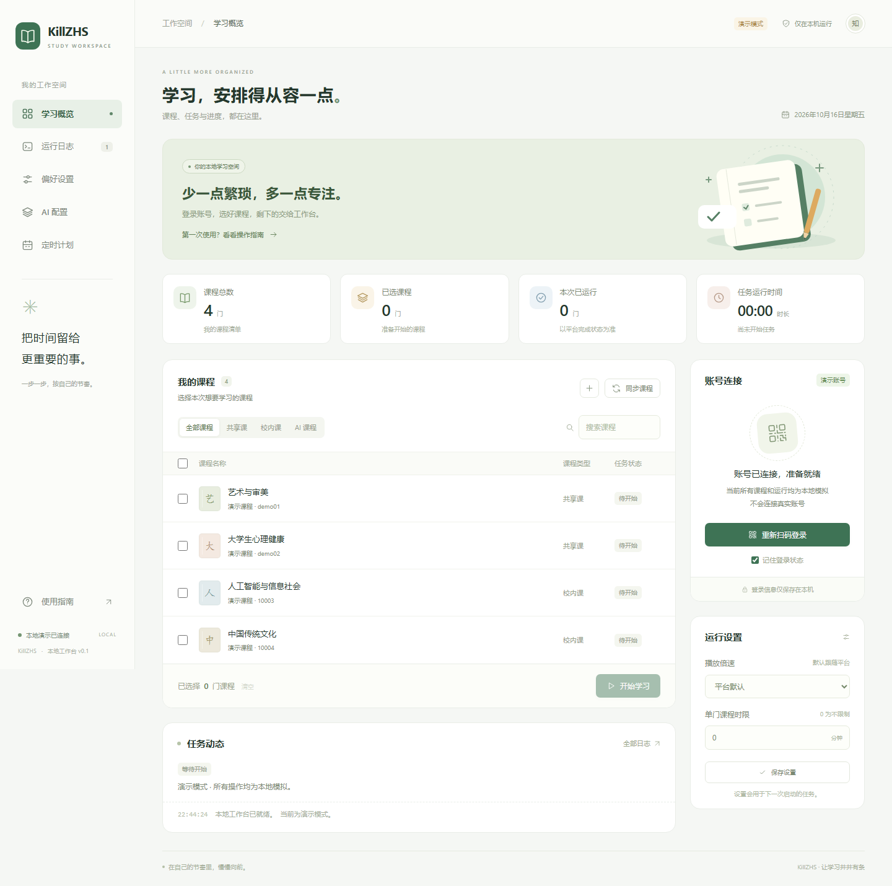
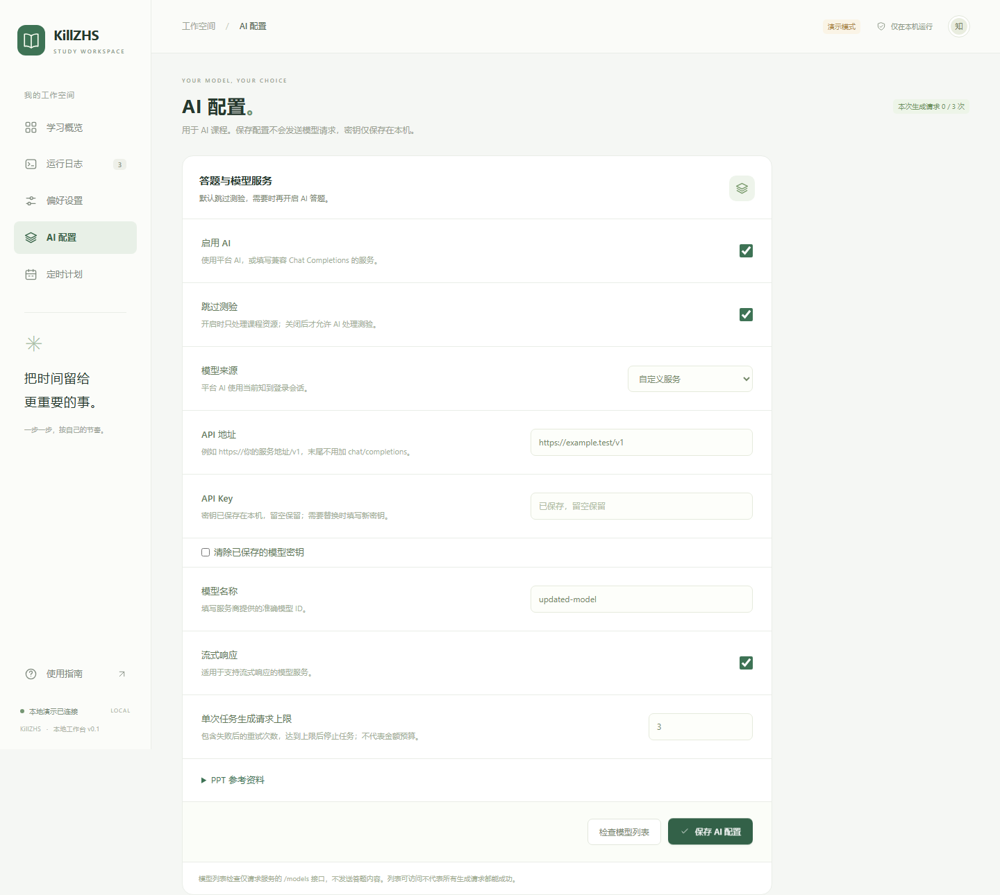
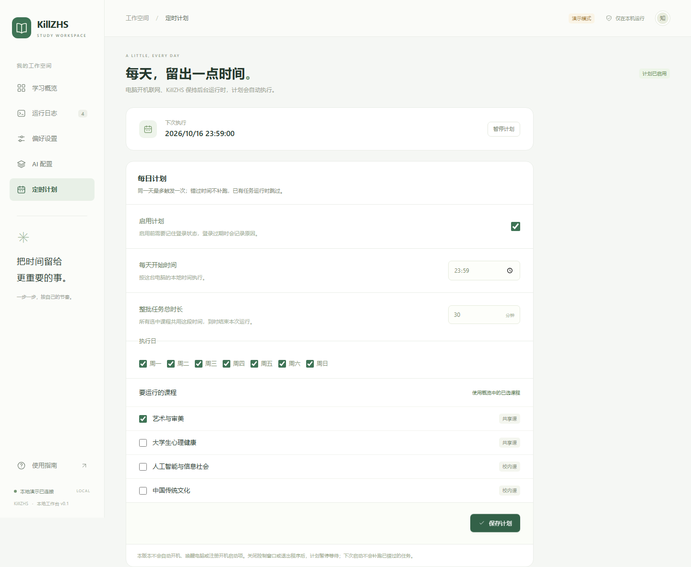

# KillZHS

智慧树 / 知到的本地网页工作台。Windows 用户解压后双击程序，即可在浏览器中登录、
选择课程、配置 AI、设置每日计划和查看运行记录。

基于 [VermiIIi0n/fuckZHS](https://github.com/VermiIIi0n/fuckZHS) 二次开发。
原作者版权与 MIT 许可证完整保留，改动说明见 [NOTICE.md](NOTICE.md)。

**当前为 `0.1.0-beta.6` 测试版。** 已完成离线测试、浏览器操作及 Windows 打包检查；
已有本机真实扫码与共享课启动记录，完整课程完成情况、AI 课程及模型生成仍需进一步验证。
本地“已运行”不等于平台认定课程已完成，实际结果以平台为准。

## 下载使用

从 [Releases](https://github.com/LilPolaris/KillZHS/releases) 下载 **Windows x64 ZIP**，
完整解压，双击 `KillZHS.exe`。不需要安装 Python 或 Node.js。
请保留同目录的 `_internal` 文件夹。程序会打开本地网页，并把后台控制窗口最小化到任务栏。

1. 使用知到 App 扫码登录，等待课程同步。
2. 勾选课程，按需设置倍速、单门课程时限或整批任务总时长。
3. 点击「开始学习」，在任务动态中查看当前状态，随时停止。

关闭网页后程序仍在后台运行。通过控制窗口，或网页「偏好设置 → 退出并停止任务」退出。
完整说明见 [Windows 使用说明](docs/WINDOWS.md)。



## 功能

- 扫码登录、复用本机登录状态；同步共享课、校内课及 AI 课程。
- 搜索、筛选和多选课程；支持粘贴课程地址或手动填写课程 / 班级 ID。
- 网页配置平台 AI、自定义模型服务、流式输出和 PPT 文件处理。
- 密钥仅保存在本机，不回传到页面；可替换或清除，保存配置不触发 API 请求。
- 任务运行中也可保存 AI 配置，下一次任务生效，当前任务继续使用启动时的设置。
- 自定义服务连接检查只请求 `/models`，不发送课程或答题内容。
- AI 生成请求上限包含失败重试，达到上限停止任务；该上限不代表金额预算。
- 每日计划：选择时间、星期、课程和总时长，默认 30 分钟。
- 按整批任务的实际经过时间控制总时长，包含课程切换与网络等待。
- 到时或点击停止后先请求收尾，尝试提交未上报的进度，最多等待 30 秒；卡住时强制终止。
- 网页状态按游标读取新增日志，历史记录未变化时不重复传输；收尾期间仍可查看状态。
- 同一天最多自动触发一次，重复启动受到实例锁保护。
- 最近 100 次任务历史及按次保存的脱敏日志，可查看和下载；每次最多 2 MB。
- 异常退出后恢复上次任务记录为“意外中断”，保留退出前已写入的日志。
- PushPlus / Bark 通知：任务结束、需要验证、登录状态不可用和计划跳过；默认关闭。
- 共享课遇到验证码后停止本批次，顶部显示验证入口，可直接打开当前课程页面。
- 验证后可按当前设置重新开始未完成课程；等待验证时，未来定时计划跳过并记录原因。
- 最近 600 条会话日志、日志导出与环境检查。
- 本机访问限制、独立用户数据目录和后台控制窗口。

## 遇到平台验证

工作台顶部会显示当前课程和「打开当前课程验证」。点击后在新的官方标签页完成验证；
若官网要求登录，请使用同一个知到账号。完成后先暂停官方播放器，返回工作台点击「验证后重新开始」。
重新开始使用当前设置并重新计时，脚本会跳过平台已完成的视频，不会重复选择本批次已经运行完的课程。
刷新网页或重启工作台后仍可保留待验证提示；旧版本记录只有课程名时，仅在名称唯一匹配时恢复课程链接。
工作台目前不自动识别、提交验证码，也不能自动确认验证已经完成；打开课程页不保证立即触发验证弹窗。

新增默认关闭的[网页验证恢复实验](docs/VERIFICATION_PROBE.md)：保留当前 worker，人工确认后仅重发一次原请求，
再观察后续正常上报与平台累计时长。未启用实验时只增加脱敏诊断日志，行为保持原样。
实验尚无真实账号的原地恢复样本，不代表已经验证可自动恢复。Windows 发布目录内可用“验证实验模式.bat”显式启动。

## AI 课程

AI 课程需要课程 ID 和班级 ID，自动同步失败时可手动添加。
默认**跳过测验**；需要处理测验时，在「AI 配置」中启用 AI 并关闭跳过测验。
自定义服务使用兼容 Chat Completions 的接口，填写服务商提供的准确模型 ID。

PPT 处理单独配置文件服务。开启后相关课件会上传到该服务，并可能产生费用；
默认开启转换后删除本次上传的服务端文件。

<details>
<summary>查看 AI 配置界面</summary>



</details>

## 每日计划

例如：每天 20:00 运行所选课程，**所有课程合计最多运行 30 分钟**。
按电脑本地时间执行，程序保持后台运行、电脑开机联网且登录有效时才可执行。

- 到时停止继续处理课程，先收尾再结束，最多额外等待 30 秒；实际进度以平台接收为准。
- 默认错过时间不补跑；可设置 1–720 分钟的补跑窗口，窗口内恢复运行时尝试一次，跨天不补跑。
- 该时刻有其他任务运行时跳过并记入历史，不会在现有任务结束后自动重试。
- 当天的尝试会先保存，重新启动程序不会重复触发同一天的计划。
- 登录过期或需要验证时，查看日志并重新登录。
- 第一版不自动开机、唤醒电脑或注册开机启动项。
- 可在运行中保存或暂停未来计划，不影响当前任务。



## 消息通知与任务日志

在「消息通知」中选择 PushPlus 或 Bark，填写自己的 Token / 设备密钥，并选择提醒事件。
保存不会发送消息；点击「发送测试通知」才会实际发送一条消息，通知无需停止当前任务。
参数说明见 [PushPlus 官方文档](https://www.pushplus.plus/doc/guide/api.html)、
[Bark 官方文档](https://bark.day.app/#/tutorial)。Bark 可使用默认服务器或自建服务器。

通知只包含运行状态，不包含密钥、完整日志或课程内容。发送在独立队列执行，失败不会阻塞任务，
不自动重试；推送服务接受请求不代表手机已经收到。演示模式不连接任何推送服务。
登录提醒来自任务执行时发现的问题，本版没有额外的定时登录探测。

「运行日志 → 历史记录 → 查看日志」可打开某一次任务的详细日志，并单独下载。
日志随任务写入本机，重启后仍可查看；超出最近 100 次的日志自动清理，每次最多 2 MB。
旧版历史记录没有详细日志，升级后不会补生成。

## 本机数据

Windows 发布版使用 `%LOCALAPPDATA%\KillZHS` 保存配置、Cookie、计划、缓存、通知设置及任务日志，
升级时替换程序目录即可保留数据。源码版默认使用 `.local/webui`。
这些文件含有私人凭据，不要分享整个用户数据目录。
原项目的 `config.json`、`cookies.json`、`execution.json` 不会被覆盖。

## 从源码运行

需要 Python 3.12 或以上，安装原有运行依赖：

```powershell
python -m venv .venv
.\.venv\Scripts\python.exe -m pip install -r requirements-lock.txt
.\.venv\Scripts\python.exe killzhs.py --desktop
```

Windows 也可双击 `启动KillZHS.bat`。普通终端模式使用 `python killzhs.py`。
保留原命令行入口 `main.py`，上游文档见 [原项目说明](docs/UPSTREAM_README.md)。

```powershell
# 离线演示，不连接平台或模型
python killzhs.py --demo

# 更换端口；不自动打开浏览器
python killzhs.py --port 8766 --no-browser

# 无控制窗口的后台服务模式
python killzhs.py --headless --no-browser
```

## 开发与构建

```powershell
python -m unittest discover -s tests -v
python -m pip install -r requirements-build-lock.txt
python scripts/build_windows.py
```

Windows 包需要在 Windows 上构建。产物位于 `output/release`，附带 SHA-256 校验值。
构建脚本使用明确的资源清单，不包含开发者的配置、Cookie、模型密钥或运行记录。
运行与构建依赖使用锁定文件；构建前会核对已安装版本，许可证从运行依赖关系自动收集，
并附带版本与许可证文件清单。刷新锁定文件使用 `python scripts/lock_dependencies.py`，
该命令只读取当前环境，不安装或升级软件。版本锁定不代表 ZIP 字节完全可复现。

CI 在 Python 3.12 / 3.14 检查基础静态错误、JavaScript 语法及离线测试，
并在 3.14 运行隔离演示环境下的浏览器流程。手动执行网页检查：

```powershell
python -m pip install -r requirements-dev.txt
python -m playwright install chromium
python scripts/browser_smoke.py
```

首次审查的逐项进度见 [审查落实情况](docs/REVIEW_STATUS.md)，
倍速与耗时的边界见 [速度分析](docs/PERFORMANCE.md)。

## 来源与许可

上游基线：`VermiIIi0n/fuckZHS@04cbbb8`。原有课程逻辑归上游作者及贡献者所有。
KillZHS 新增网页控制、AI 配置、计划与历史、Windows 分发流程，并修复了无终端环境、
API 地址拼接、PPT 服务地址与文件隔离等接入问题。

本项目采用 [MIT](LICENSE)。与原作者及智慧树平台无隶属关系，请按课程及平台规则使用。
